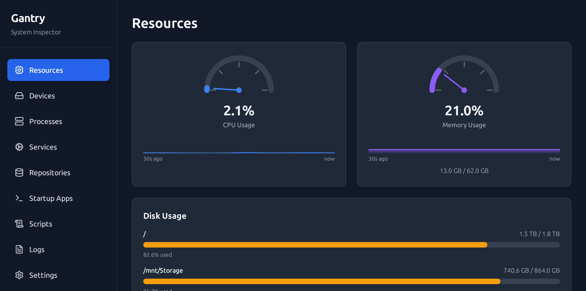
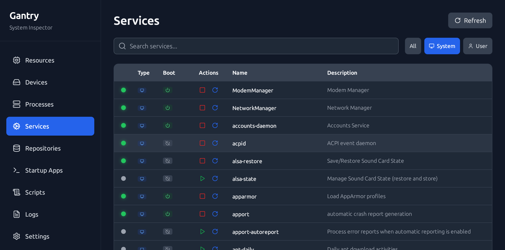
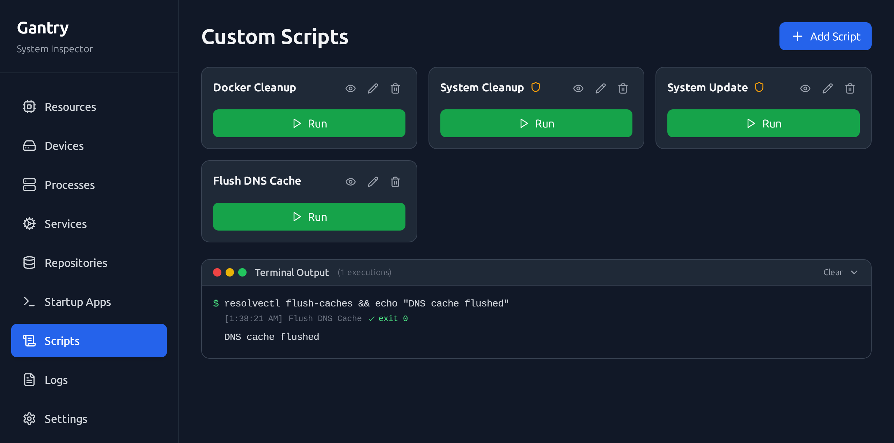

# Gantry

A lightweight system management desktop app built with Tauri and React. Monitor your machine, manage services, control packages, and run scripts — all from one clean interface. Runs on **Linux** and **macOS**: where Linux uses systemd and APT or pacman, macOS uses launchd and Homebrew, and the UI adapts automatically.

## Screenshots





## Features

**Resources** — Live CPU, memory, GPU, disk, and network monitoring with historical sparkline graphs. Per-core breakdown, thermal sensors grouped by device (CPU, GPU, NVMe, DIMM, network adapter), fan speeds, load average, and uptime.

**Processes** — Grouped process list with CPU/memory usage. End individual processes or entire groups (SIGTERM first, SIGKILL only if they do not exit). Live auto-refresh mode, sortable columns, and search by name or PID.

**Services** — Browse and manage systemd services (user + system). Start, stop, restart, enable, and disable with live status indicators.

**Devices** — Hardware overview: block devices, PCI, USB, network interfaces, input devices, and processor info. OS/kernel info card at the top. Click any value to copy it.

**Repositories** — View, add, enable/disable, and delete package sources. On Debian/Ubuntu this manages APT sources (both `.list` and DEB822 `.sources` formats), on Arch-based distributions the repository sections of `/etc/pacman.conf`.

**Packages** (pacman) — Pending updates, orphaned packages, package cache size with one-click cleanup, and `.pacnew`/`.pacsave` files waiting to be merged. Live update checks and cache pruning use `pacman-contrib` when it is installed.

**Startup Apps** — Full CRUD for XDG autostart entries. Add, edit, toggle, and delete `~/.config/autostart` desktop files; system-wide entries from `/etc/xdg/autostart` are listed too and can be switched off.

**Scripts** — Create and run custom shell scripts with optional sudo and prompts. Group them into collapsible categories with an icon of your choice, and drag scripts and categories to reorder them or move a script to another category; the order and the collapsed state are saved in `scripts.yaml`. Output is displayed inline, and long-running scripts show as running without blocking the app.

**System Report** — One-click hardware summary (OS, CPU, RAM, GPU, storage) formatted for pasting into support tickets or GitHub issues.

## Installation

### APT (Ubuntu / Debian)

```bash
curl -fsSL "https://packages.buildkite.com/cedric-lefebvre/ppa/gpgkey" \
  | sudo gpg --dearmor -o /etc/apt/keyrings/cedric-lefebvre_ppa-archive-keyring.gpg

echo -e "deb [signed-by=/etc/apt/keyrings/cedric-lefebvre_ppa-archive-keyring.gpg] https://packages.buildkite.com/cedric-lefebvre/ppa/any/ any main\ndeb-src [signed-by=/etc/apt/keyrings/cedric-lefebvre_ppa-archive-keyring.gpg] https://packages.buildkite.com/cedric-lefebvre/ppa/any/ any main" \
  | sudo tee /etc/apt/sources.list.d/buildkite-cedric-lefebvre-ppa.list

sudo apt update && sudo apt install gantry
```

Once set up, `sudo apt upgrade` will keep Gantry up to date automatically.

### Arch Linux (and derivatives)

Download the `.pkg.tar.zst` from the [releases page](https://github.com/Cedric-Lefebvre/gantry/releases) and install it with `sudo pacman -U gantry-*.pkg.tar.zst`, or build the package from a checkout of this repository:

```bash
git clone https://github.com/Cedric-Lefebvre/gantry.git
cd gantry/packaging/arch
makepkg -si
```

`makepkg` installs the build and runtime dependencies for you. To update, pull the repository and run `makepkg -si` again.

### Manual Download

Download the latest `.deb`, `.rpm`, or `.AppImage` from the [releases page](https://github.com/Cedric-Lefebvre/gantry/releases).

### macOS

Download the latest `.dmg` from the [releases page](https://github.com/Cedric-Lefebvre/gantry/releases) — pick `aarch64` for Apple Silicon or `x64` for Intel — open it, and drag **Gantry** into `Applications`.

Because the app is not yet signed with an Apple Developer ID, Gatekeeper will block it on first launch ("Gantry can't be opened because Apple cannot check it for malicious software"). Clear the download quarantine flag once:

```bash
xattr -dr com.apple.quarantine /Applications/Gantry.app
```

Alternatively, right-click the app in Finder and choose **Open**, then confirm in the dialog.

> **Note:** On macOS, the package and service features map to the platform's native tooling — *Repositories* manages Homebrew taps (requires [Homebrew](https://brew.sh)) and *Services* / *Startup Apps* manage launchd agents and daemons. Privileged scripts and service actions prompt for credentials via the standard macOS admin dialog.

### CLI

```bash
gantry            # launch the app
gantry --version  # print version
gantry --help     # print help
```

### Build from Source

- Node.js 18+
- Rust 1.95+
- [Tauri system dependencies](https://tauri.app/start/prerequisites/) (on macOS: Xcode Command Line Tools — `xcode-select --install`)

```bash
git clone https://github.com/Cedric-Lefebvre/gantry.git
cd gantry
npm install
npm run tauri dev     # development
npm run tauri build   # production
npm run typecheck     # TypeScript check
```

## Testing

Gantry has an end-to-end test suite that drives the real app via WebdriverIO + tauri-driver.

### Prerequisites (one-time)

```bash
# Tauri's WebDriver wrapper
cargo install tauri-driver

# WebKitWebDriver (webkit2gtk)
sudo apt install webkit2gtk-driver   # Ubuntu 22.04
# or
sudo apt install webkitgtk-6.0-injected-bundle  # Ubuntu 24.04+
# Arch: the webkit2gtk-4.1 package does not ship WebKitWebDriver,
# so the suite cannot run against the stock package there

# Build the release binary first (tests run against the real binary)
npm run tauri:build
```

### Run

```bash
npm run test:e2e
```

`wdio.conf.cjs` automatically starts `tauri-driver`, launches the app, runs all 6 spec files sequentially, and tears everything down. A display is required (Xorg or Wayland with XWayland).

### Specs

| File | What it covers |
|------|---------------|
| `01-navigation` | Sidebar links, active highlight |
| `02-resources` | CPU / memory / disk widgets load |
| `03-processes` | Process list, search, refresh |
| `04-devices` | Hardware cards, collapse/expand |
| `05-services` | Service list, search, tabs |
| `06-scripts` | Full CRUD: add → run → delete, prompt variables |

## Configuration

```
~/.config/gantry/        # ~/Library/Application Support/gantry on macOS
├── scripts.yaml         # custom scripts and their categories
├── settings.yaml        # theme and preferences
└── app.log              # warnings and errors
```

Versions before 0.3.0 used `~/.gantry`; it is moved to the new location on first launch.

## Tech Stack

- **Frontend**: React 19, TypeScript, Tailwind CSS
- **Backend**: Rust, Tauri 2.0

## License

[MIT](LICENSE)
